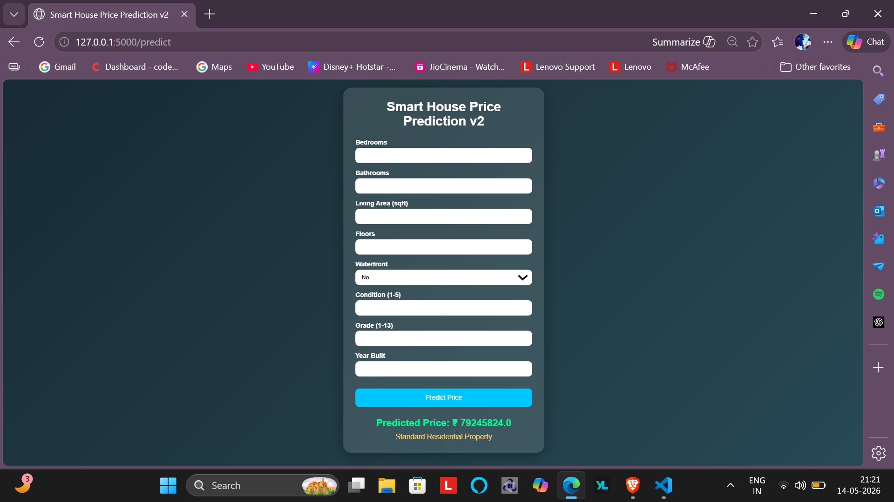
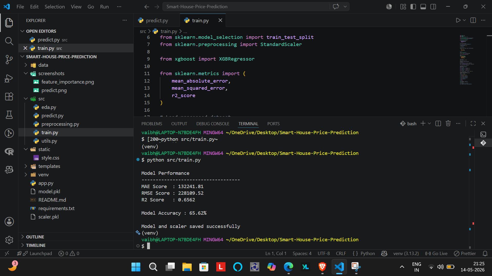
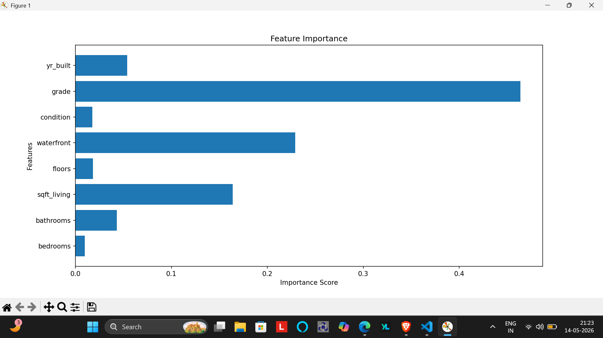

# 🏡 Smart House Price Prediction

### Machine Learning · Python · Flask · Scikit-learn

A machine learning web application that predicts house prices using a trained regression model. The project combines data preprocessing, feature scaling, model training, and a Flask-based web interface to make house price prediction accessible through a simple user experience.

<p align="center">
  
</p>

---

## 📌 Overview

House prices depend on multiple property characteristics and market-related factors. This project explores how machine learning can learn patterns from historical housing data and use them to estimate prices for new inputs.

**Smart House Price Prediction** provides an end-to-end implementation of a basic machine learning workflow, from preparing data to serving predictions through a web application.

## ✨ Key Features

- 🤖 **Machine Learning:** Uses a trained regression model to estimate house prices.
- 🧹 **Data Preprocessing:** Prepares housing data for machine learning.
- 📏 **Feature Scaling:** Uses a saved scaler to transform input features.
- 🌐 **Flask Web Application:** Provides a browser-based interface for predictions.
- 📊 **Model Analysis:** Includes visualizations for accuracy-related evaluation and feature importance, where applicable.
- 🔮 **Price Prediction:** Generates estimates from user-provided property information.
- 🗂️ **Saved Artifacts:** Stores the trained model and scaler for inference without retraining on every request.

## 🛠️ Tech Stack

| Technology | Purpose |
|---|---|
| Python | Core programming language |
| Pandas & NumPy | Data handling and numerical operations |
| Scikit-learn | Machine learning and preprocessing |
| Flask | Web application and prediction interface |
| HTML & CSS | Frontend interface |
| Matplotlib / Seaborn | Data visualization, if used in the analysis scripts |

## 🧠 Machine Learning Workflow

```text
Housing Dataset
      ↓
Data Exploration & Preprocessing
      ↓
Feature Preparation
      ↓
Model Training & Evaluation
      ↓
Save Trained Model + Scaler
      ↓
Flask Web Application
      ↓
User Inputs → Prediction → Estimated Price
```

The saved model and scaler allow the application to reuse the trained pipeline artifacts when making predictions.

## 📂 Project Structure

```text
Smart-House-Price-Prediction/
│
├── app.py
├── model.pkl
├── scaler.pkl
├── requirements.txt
├── README.md
│
├── data/
│   ├── kc_house_data.csv
│   └── processed_data.csv
│
├── src/
│   ├── eda.py
│   ├── predict.py
│   ├── preprocessing.py
│   ├── train.py
│   └── utils.py
│
├── static/
│   └── style.css
│
├── templates/
│   └── index.html
│
└── screenshots/
    ├── accuracy.png
    ├── feature_importance.png
    └── prediction.png
```

## ⚙️ Getting Started

### Prerequisites

- Python 3.10 or later, subject to compatibility with your installed dependencies
- pip
- Git

### 1. Clone the repository

```bash
git clone https://github.com/gradientvb/Smart-House-Price-Prediction.git
cd Smart-House-Price-Prediction
```

### 2. Create a virtual environment

**Windows — PowerShell**

```powershell
python -m venv venv
.\venv\Scripts\Activate.ps1
```

### 3. Install dependencies

```bash
pip install -r requirements.txt
```

### 4. Run the application

```bash
python app.py
```

Open the local address displayed in your terminal, commonly:

`http://127.0.0.1:5000`

Enter the required property details to generate a prediction.

> **Note:** The application expects the saved model and scaler to be available at the paths configured in the project. If they are missing, follow the project's training workflow before running predictions.

## 📸 Screenshots

### Prediction Interface


### Model Evaluation



### Feature Importance



## 🎯 Learning Outcomes

Through this project, I explored:

- The end-to-end machine learning development workflow.
- Data preprocessing and feature transformation.
- Training and saving a regression model.
- Integrating a trained model into a Flask application.
- Connecting backend prediction logic with a frontend interface.
- Organizing a Python project for reproducibility and version control.

## 🚀 Future Improvements

- Compare multiple regression algorithms.
- Improve model evaluation and hyperparameter tuning.
- Add interactive visualizations and prediction explanations.
- Deploy the application to a cloud platform.
- Expand input validation and automated testing.

## 👨‍💻 Author

**Vaibhav Bhardwaj**

B.Tech Computer Science & Engineering — Data Science

- GitHub: [@gradientvb](https://github.com/gradientvb)

---

⭐ If you find this project interesting, consider giving the repository a star!
